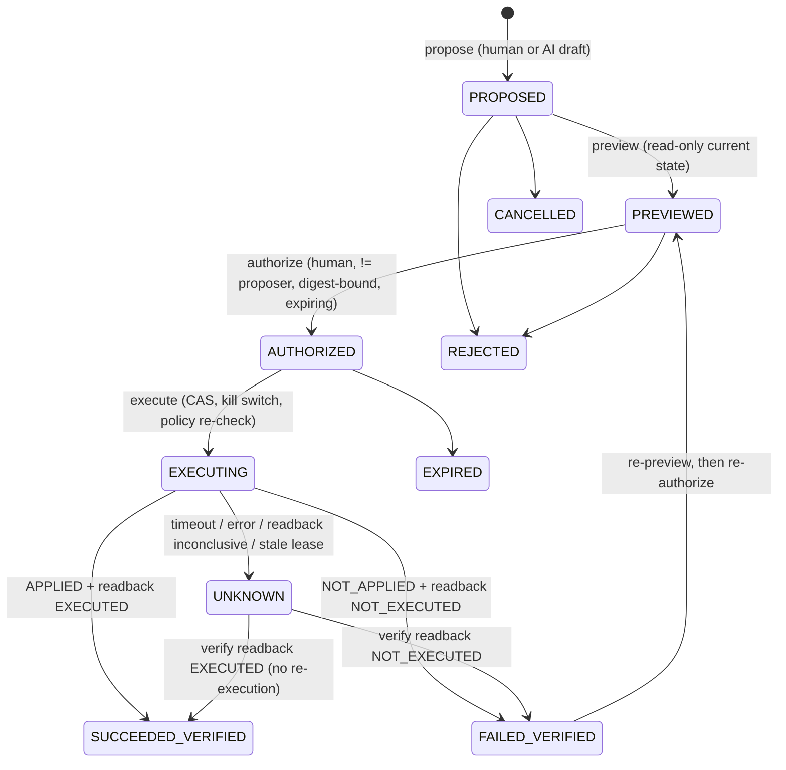

# Governed commercial action runtime (R2, experimental)

Date 2026-11-18. Branch `work/r2-governed-actions` (base 8673ca8). Non-canonical, no HTTP routes, no live executor. Does not decide PM-1, CE-1 or CE-2 and closes no Human Gate.

## Provenance of this work

Implemented by Subagent G/D. The agent stopped on an API usage-limit error after code and tests were written but before committing and reporting. The root orchestrator reviewed the uncommitted work, ran the gates below, wrote this report and committed it. This is **not** an independent review; Subagent I/A review is still required.

## Lifecycle

## Guarantees enforced in code

| Rule | Where | Test |
|---|---|---|
| Arguments frozen as canonical JSON + SHA-256 digest at proposal; approval binds the reviewed digest | `domain/governed-action/canonical-json.ts`, `action-lifecycle.ts` | domain + authorization specs |
| AI proposals are drafts; AI can never authorize, execute or resolve outcomes (I-03) | `action-lifecycle.ts` | authorization spec |
| Separation of duties: approver ≠ proposer; approval expires | `action-lifecycle.ts` | authorization spec |
| Kill switch (global/capability) at authorize, execute and immediately before dispatch | `governed-action.service.ts` | execution spec |
| At most one in-flight execution: CAS on `version`; DB trigger requires +1 version | service, `pg-action.store.ts`, migration 011 | PG integration (concurrent) |
| UNKNOWN is never retried; only `verify` (readback) resolves it; verify never re-executes | service `verify` | execution spec |
| NOT_EXECUTED readback requires re-preview and re-authorization | `action-lifecycle.ts` | execution spec |
| Stale EXECUTING lease (crash) becomes UNKNOWN, then verify | `recoverStaleExecution` | execution spec |
| Append-only events; UPDATE/DELETE/TRUNCATE on events rejected by triggers (I-05) | migration 011 | PG integration |
| Workspace-scoped uniqueness and access (I-09) | migration 011, service `load` | authorization + PG specs |
| Budget delta / protected-account constraints | `action-constraints.ts` | authorization spec |
| Only `DisabledExecutor` (default) and `SyntheticExecutor` exist | `infra/governed-action/*` | infra spec |

## Verification (root, 2026-11-18, local PostgreSQL 17, `disposable_r2_actions`)

- `npx tsc --noEmit`: pass. `npm run lint`: pass. `npm run architecture:check:strict`: PASS (0 findings).
- `npm test -- --exclude '**/*.integration.spec.ts'`: 42 files, 467 passed.
- `TEST_DATABASE_URL=… npx vitest run src/infra/governed-action src/infra/postgres --no-file-parallelism`: 11 files, 45 passed, 0 skipped.
- Migration 011 added to `requiredSuites`; `completion-provenance.integration.spec.ts` made robust to later migrations (rolls back the tail through 009 and reapplies) instead of assuming 009 is last.

## Mapping to prior research (examples only, all disabled)

`ads.campaign.budget.update` (Meta/Google/TikTok Ads, budget-delta constraint, protected accounts), `pancake.message.send` (conversation reply; consequential, irreversible), POS order/status changes. Each would need a provider-specific readback that can distinguish EXECUTED vs NOT_EXECUTED; where a provider cannot, outcomes legitimately remain UNKNOWN.

## Required before any live executor

Provider rights and approved credentials; PM-1 permission matrix (who may authorize which capability); Human Gate for consequential mutations; HTTP surface with OIDC/membership; per-capability readback contracts; rate limits; operator UI for preview/approval. **No live writes exist in this code.**

## Review fixes (2026-11-18, branch `work/r2-fix-actions`, base 93c39d9)

Fixes for the independent architecture review (`architecture-canonical-review.md`: A-M1, A-M3, A-M4, A-m1, A-m2, A-m3) and the independent QA findings R2-I-01, R2-I-14, R2-I-15. Nothing here decides PM-1, LG-1, MM-1, CE-1 or CE-2, and no Human Gate is closed. Migration 011 is unreleased and was edited in place; up and down remain symmetric.

Failing-first evidence: a throw-away probe spec run against the unmodified base code failed 9/9. It covered A-M1 evidence in events, A-m1 version bump, AI expire, expire attribution, the service grant, the empty catalog, the leadId format, the per-attempt key and the stale baseline. The QA repro `governed-action.r2-review.spec.ts` (copied from 4ec9bd1) failed on the base as `it.fails`.

| Finding | Fix | Regression tests |
|---|---|---|
| **A-M1** (I-05, I-12) history incomplete | Event data now carries everything needed to rebuild the projection. **PREVIEWED:** full `beforeState`, `changes`, `argumentDigest`, `previewDigest`. **AUTHORIZED:** the reviewed `previewDigest`. **EXECUTION_STARTED:** per-attempt key, `approvedPreviewDigest`, and the execute-time `currentState`. **OUTCOME_RECORDED:** `executorStatus`, `executorReason`, `providerReference`, full `verification` (observation, evidence, reason, observedAt) and `triggeredBy`. **VERIFICATION_RECORDED:** the full `verification`. New `domain/governed-action/action-history.ts`: `replayLifecycle` rebuilds `state/version/attempts/preview/approval/execution/outcome` from events and re-checks each preview digest; `attemptHistory` lists the evidence for each attempt. The projection is now only a cache. | `governed-action.review-fixes.spec.ts` › "FAILED_VERIFIED attempt 1 → re-preview → re-authorize → SUCCEEDED attempt 2…" (in-memory); `governed-action.review-fixes.integration.spec.ts` › "A-M1: after FAILED → re-authorize → SUCCEEDED…" (PostgreSQL, fresh pool); `action-history.spec.ts` (replay equals projection; forged or gapped history is rejected) |
| **A-M4** (I-09) reads and housekeeping not policy-gated | `ActionPolicy` gains `mayRead(get/history/refusals)`, `mayHousekeep(expire/recover)` and the lead-scope hook `mayAccessLead`. `DenyAllActionPolicy` denies all three. `get`, `history` and the new `refusals` go through `mayRead`. `expire` and `recoverStaleExecution` go through `mayHousekeep`, and AI is refused in both the service and the domain. On a lead-linked proposal, **every** command first passes `mayAccessLead` (`// OPEN: PM-1` at the seam). An out-of-scope actor gets `NOT_FOUND`, and the refusal is logged as `LEAD_SCOPE_DENIED`. `leadId` must be a UUID, normalised to lower case, and is stored in a `lead_id UUID` column. Existence and assignment checks belong to the hook implementation. | review-fixes spec › "get / history / refusals consult ActionPolicy.mayRead…", "every command on a lead-linked proposal passes the lead-scope hook…", "validates leadId…", "expire and recover require housekeeping authority…" |
| **A-m1** refusals block legitimate commands | Refusals are no longer events. `recordRefusal` returns an `ActionRefusal` that is appended through `ActionStore.appendRefusal`. On PostgreSQL this is the new `governed_action_refusal` table: append-only through triggers, FK to the proposal, and outside the version CAS. `COMMAND_REFUSED` is removed from the event types. The service exposes `refusals()`. | review-fixes spec › "a burst of refused commands during a legitimate authorize does not make it lose the CAS"; PG › "A-m1: the refusal log is append-only…"; infra spec › "A-m1: refusals are appended to a separate log…" |
| **R2-I-01** refusal during EXECUTING loses the outcome | Fixed by A-m1: an in-flight dispatcher's outcome CAS can no longer be broken by a refused command. | `governed-action.r2-review.spec.ts` (QA, the two `it.fails` flipped to `it`); PG › "R2-I-01: a refused duplicate execute / AI verify while EXECUTING…" |
| **A-m2** actor kind trusted from the caller | Commands now take an `ActionPrincipal` (`id`, `workspaceId`). The kind comes from the required `ActorResolver` port (`// OPEN: PM-1` for the credential → kind mapping). A caller-supplied `kind` is ignored. An unresolvable principal, a resolver error or an id mismatch is refused. A `service` actor may execute or verify only when the policy decision carries `serviceGrant: true`, enforced in the domain (`requireRunAuthority`); the default is deny. `StaticActorResolver` and `DenyAllActorResolver` are provided. | review-fixes spec › "ignores a caller-claimed kind…", "a service actor cannot execute or verify unless the policy explicitly grants it"; `action-history.spec.ts` › "A-m2: a service actor needs an explicit serviceGrant…" |
| **A-m3** expiry and recovery recorded as `system` | `expire` and `markStaleExecution` take a `HousekeepingInput` with the real actor and a `trigger` (`command`, `execute` or `sweep`). `system` is accepted only for a genuine sweep. An approval expiry seen at execute is attributed to the executing actor. The runtime-produced `OUTCOME_RECORDED` stays `system` and records `triggeredBy`. | review-fixes spec › "A-m3: stale-execution recovery and approval expiry at execute are attributed…"; `action-history.spec.ts` › "A-m3: …" |
| **A-M3** (LG-1, MM-1) catalog decides scope | `PRODUCTION_CAPABILITY_CATALOG` ships **empty** (deny-all, `// OPEN: LG-1`, `// OPEN: MM-1`). The catalog is an injected `CapabilityCatalog` dependency (default: production). The concrete entries moved to the test-only `domain/governed-action/testing/synthetic-capabilities.fixture.ts`, which only specs and the synthetic runtime reference. `family` is now an opaque string. Migration 011 seeds nothing. | domain spec › "A-M3: the production catalog ships empty…"; infra spec › "only specs and the synthetic runtime import the synthetic capability fixture…", "migration 011 creates storage only and seeds no capabilities" |
| **R2-I-14** stale baseline at execute | `execute` re-reads the current state through the read-only verifier port and evaluates constraints against it. If the baseline differs from the reviewed preview, or cannot be read, the command fails with `PREVIEW_STALE` and nothing is dispatched; re-preview and re-authorize are required. | review-fixes spec › "a baseline that moved after approval refuses with PREVIEW_STALE…" |
| **R2-I-15** idempotency key reused across attempts | The execution key is per attempt (`ga-<id>-<attempt>`). Readback or verify of the same attempt reuses that attempt's key. The proposal-level `idempotency_key` stays unique per workspace. | execution spec (keys `-1`, `-2`); review-fixes spec › "UNKNOWN resolved by verify keeps … the attempt key" |

QA-spec note: `governed-action.r2-review.spec.ts` is unchanged except for two edits. The two defect tests went from `it.fails` to `it`. The third test, "evidence of current behaviour", asserted the defect, so it went from `it` to `it.fails`; it now documents that the defect is gone.

Verification (local PostgreSQL 17, `disposable_r2_fix_actions`):
- `npm run typecheck`: pass.
- `npm run lint`: pass.
- `npm run architecture:check:strict`: PASS (0 findings).
- `npm test -- --exclude '**/*.integration.spec.ts'`: 62 files, 727 passed, 1 expected fail (the QA evidence test above).
- `TEST_DATABASE_URL=… npx vitest run src/infra/governed-action src/infra/postgres --no-file-parallelism`: 12 files, 52 passed, 0 skipped.

Remaining limitations:
- No production `ActorResolver` or lead-scope hook is wired. The HTTP and identity seam must map credential types to kinds and back `mayAccessLead` with the lead store and lead RBAC (PM-1).
- The refusal log can grow under abuse. Rate limiting belongs to the future HTTP layer.
- Execute-time staleness compares the whole observed baseline, so an unrelated provider-side field change also forces re-approval (fail closed).
- Per-attempt keys mean a provider that applied attempt *n* late, after a NOT_EXECUTED readback, is not deduplicated against attempt *n+1*. Per-capability readback and idempotency contracts are still required before any live executor.
- A-M2 (AI proposals without a CE or evidence pointer) is a Gate #A question and is untouched.
