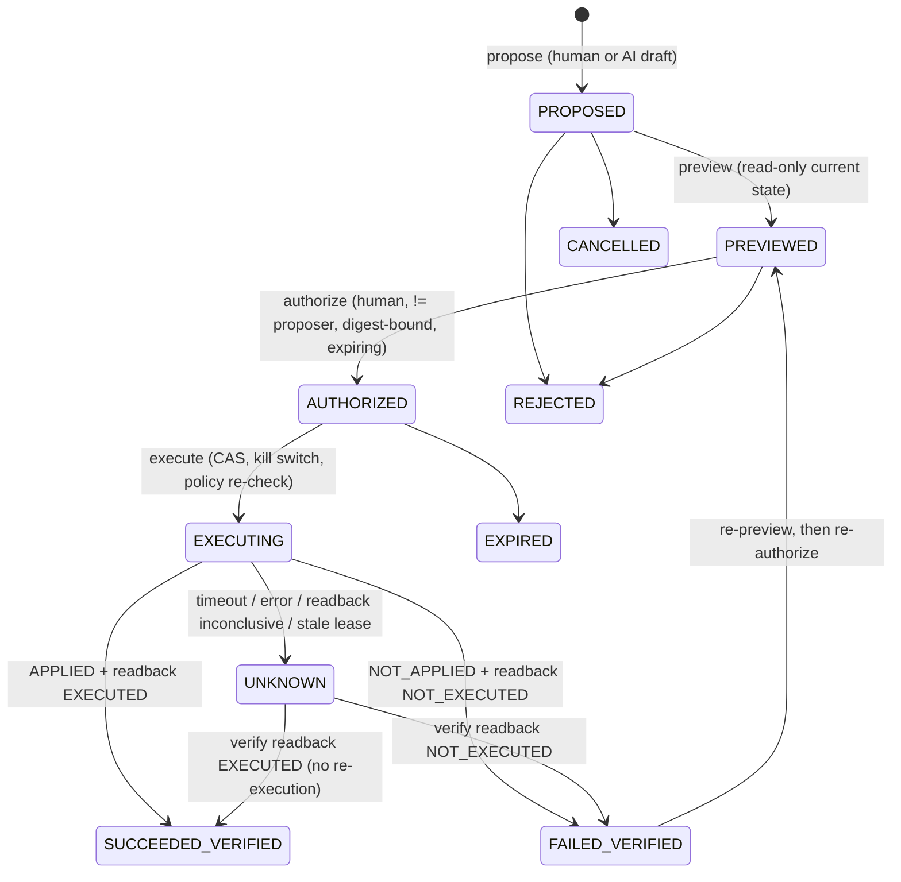

# Governed commercial action runtime (R2, experimental)

Date 2026-11-18. Branch `work/r2-governed-actions` (base 8673ca8). Non-canonical, no HTTP routes, no live executor. Does not decide PM-1, CE-1 or CE-2 and closes no Human Gate.

## Provenance of this work

Implemented by Subagent G/D. The agent stopped on an API usage-limit error after code and tests were written but before committing and reporting. The root orchestrator reviewed the uncommitted work, ran the gates below, wrote this report and committed it. This is **not** an independent review; Subagent I/A review is still required.

## Lifecycle

## Guarantees enforced in code

| Rule | Where | Test |
|---|---|---|
| Arguments frozen as canonical JSON + SHA-256 digest at proposal; approval binds the reviewed digest | `domain/governed-action/canonical-json.ts`, `action-lifecycle.ts` | domain + authorization specs |
| AI proposals are drafts; AI can never authorize, execute or resolve outcomes (I-03) | `action-lifecycle.ts` | authorization spec |
| Separation of duties: approver ≠ proposer; approval expires | `action-lifecycle.ts` | authorization spec |
| Kill switch (global/capability) at authorize, execute and immediately before dispatch | `governed-action.service.ts` | execution spec |
| At most one in-flight execution: CAS on `version`; DB trigger requires +1 version | service, `pg-action.store.ts`, migration 011 | PG integration (concurrent) |
| UNKNOWN is never retried; only `verify` (readback) resolves it; verify never re-executes | service `verify` | execution spec |
| NOT_EXECUTED readback requires re-preview and re-authorization | `action-lifecycle.ts` | execution spec |
| Stale EXECUTING lease (crash) becomes UNKNOWN, then verify | `recoverStaleExecution` | execution spec |
| Append-only events; UPDATE/DELETE/TRUNCATE on events rejected by triggers (I-05) | migration 011 | PG integration |
| Workspace-scoped uniqueness and access (I-09) | migration 011, service `load` | authorization + PG specs |
| Budget delta / protected-account constraints | `action-constraints.ts` | authorization spec |
| Only `DisabledExecutor` (default) and `SyntheticExecutor` exist | `infra/governed-action/*` | infra spec |

## Verification (root, 2026-11-18, local PostgreSQL 17, `disposable_r2_actions`)

- `npx tsc --noEmit`: pass. `npm run lint`: pass. `npm run architecture:check:strict`: PASS (0 findings).
- `npm test -- --exclude '**/*.integration.spec.ts'`: 42 files, 467 passed.
- `TEST_DATABASE_URL=… npx vitest run src/infra/governed-action src/infra/postgres --no-file-parallelism`: 11 files, 45 passed, 0 skipped.
- Migration 011 added to `requiredSuites`; `completion-provenance.integration.spec.ts` made robust to later migrations (rolls back the tail through 009 and reapplies) instead of assuming 009 is last.

## Mapping to prior research (examples only, all disabled)

`ads.campaign.budget.update` (Meta/Google/TikTok Ads, budget-delta constraint, protected accounts), `pancake.message.send` (conversation reply; consequential, irreversible), POS order/status changes. Each would need a provider-specific readback that can distinguish EXECUTED vs NOT_EXECUTED; where a provider cannot, outcomes legitimately remain UNKNOWN.

## Required before any live executor

Provider rights and approved credentials; PM-1 permission matrix (who may authorize which capability); Human Gate for consequential mutations; HTTP surface with OIDC/membership; per-capability readback contracts; rate limits; operator UI for preview/approval. **No live writes exist in this code.**
