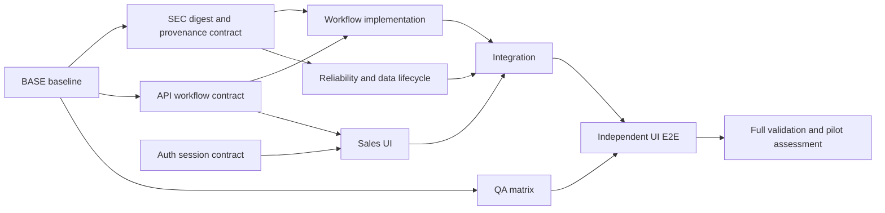

# R4 — LVP Closure: execution plan

Status: baseline verified; first-wave implementation active. No release approval implied.

## Baseline assessment

- R3 HEAD and remote: bcbbc095dd029c1aceac8b9e428bfadd05507fe4, clean feature worktree.
- Main: 5d6c206, untouched; existing research and user changes remain in the original worktree.
- R4 integration: D:/AI-for-Enterprise/ns-r4-gaps, feat/r4-lvp-closure, created from R3; existing work/r4-capability-gaps retained.
- PR #2 remains draft into feat/adaptive-integration-pancake-research; exact-head hosted product/browser checks pass.
- Fresh locked npm ci on R4 succeeds; five moderate dependency advisories reported, no audit fix applied.
- Earlier same-day verified R3 evidence: 1,032 tests / 91.08% lines, 64 PG integration, 22 HTTP, 4 browser, MV3 pass. Reverification is running; these figures are not yet R4 results.
- Principal gaps: no complete UI journey, evidence viewer/context editing/reopen/correction, provenance lost in projection, unkeyed manual/action content digests, thin telemetry, best-effort assertion delivery, missing pilot data lifecycle.
- Frozen boundaries: modular monolith, append-audited evidence, AI draft-only, CE-1/ID-1/ID-2 open; accepted ADR-005…009 retained. No canonical edits or provider enablement.

## Staffing and ownership

The runtime allows three child agents concurrently. Six specialist roles run in waves; each writer has an isolated worktree. No worker edits the integration worktree.

| Role | Owner | Worktree | Initial state |
|---|---|---|---|
| Orchestration / auth session / composition | root | ns-r4-gaps | active |
| Security & Data Integrity | r4_security | ns-r4-security | active, migration012 design reviewed |
| Backend Commercial Workflow | r4_workflow | ns-r4-workflow | active, migration013/API contract reviewed |
| QA & E2E | r4_qa | ns-r4-qa | early matrix committed f47ad3f, integrated as f6453c1; later QA pending |
| Frontend & Sales UX | r4_ux | ns-r4-ux | active after API contract |
| Reliability & Data Lifecycle | r4_reliability (second wave) | dedicated worktree | pending schema ownership review |
| Product & Architecture Review | independent reviewer (final wave) | read-only snapshot / report worktree | pending integrated checkpoint |

Initial subagent launch failed because inherited model cx/gpt-6.1-sol is unavailable to spawn_agent (no numeric error code). User explicitly selected gpt-6.1-sol; Security, Backend, QA and then UX were successfully created with that model, within the three-child concurrency cap.

Fresh baseline result: locked install + typecheck/lint/architecture/registry/build/audit PASS; 14 PG suites/64 tests, 91 coverage suites/1,032 tests (no skips), 91.08% lines, 22 HTTP, four browser, MV3 PASS. Dedicated local PG17 cluster created and stopped. Full logs referenced in baseline-verification.json. This is bcbbc09 evidence before production code changes.

## Task graph

## Backlog and acceptance

| ID | Priority / owner | Scope and likely files | Dependencies | Acceptance / tests | Risk | Status / evidence |
|---|---|---|---|---|---|---|
| BASE | P0 root | Git/PR + full R3 validation | none | exact SHA; clean install; PG/unit/HTTP/browser/MV3 recorded | shared DB must never be used | in progress |
| SEC-01 | P0 Security | envelope/manual/Pancake/action digest + crypto port/infra; migration 012 reserved | BASE | workspace-keyed versioned HMAC, kid/rotation, historical evidence readable, idempotent legacy retry; negative crypto/PG tests | immutable history/key loss | design review required |
| SEC-02 | P0 Backend with Security review | provenance query/detail/evidence/telemetry | SEC-01 contract | explicit synthetic labels + scope/filter; no synthetic business analysis; memory/PG/HTTP negatives | classification loss | pending |
| API-01 | P0 Backend | context/evidence/action/correction API; application/pilot, api, store; migration 013 reserved | BASE | typed endpoints; ownership/viewer checks; append-only context/work history; CAS/idempotency; unit/PG/HTTP tests | concurrency/history | pending contract |
| AUTH-01 | P0 root | ports/browser-session, infra/auth/browser-*, api/session, composition | BASE | OIDC auth-code PKCE, HttpOnly session, state/nonce, CSRF, logout/expiry/revocation; no production token paste; local IdP tests | cookie/token/redirect trust | pending design |
| UX-01 | P0 Frontend | operator client components/assets | API-01/AUTH-01 contracts | login/create/context/handoff/evidence/action/outcome/audit through real backend; accessible loading/error/forbidden recovery | API drift | pending |
| REL-01 | P1 Reliability | governed-action outbox/store/worker; migration 014 reserved | SEC-01 | transaction atomicity, retry/backoff/idempotent replay, visible failure; PG fault tests | delivery duplication | pending |
| DATA-01 | P0 Reliability | pilot export/delete/anonymize/retention policy; migration 015 reserved | API-01/SEC-01 | admin scoped export + safe erasure without audit destruction; hold/policy checks; synthetic/real separation; tests/runbook | irreversible policy vs immutable evidence | design review required; no real deletion |
| LEARN-01 | P0 root/Backend | bounded product telemetry + client instrumentation | API-01/SEC-02 | actual journey signals/exposure, categorical fields, no PII/body in telemetry, synthetic excluded from business aggregates | privacy | pending |
| QA-01 | P0 QA | early acceptance/security/browser matrix | BASE/contracts | identify API-seeded tests; negative/concurrency/refresh plan; no production edits | false-green acceptance | pending |
| QA-02 | P0 QA | full UI journey with test IdP/accounts only | integrated UX/API/auth | no API lead/handoff seeding; workspace/viewer/synthetic/stale/duplicate/restart coverage | test-vs-real IdP boundary | pending |
| ARCH-01 | P0 independent reviewer | goals → code → tests; final assessment | integration | invariant/ADR review; no provider/production claims; remaining tasks explicit | scope creep | pending |
| VALIDATE | P0 root | complete locked checks + coverage/PG/HTTP/browser/MV3/audit | all integrated | no skips; exact SHA; failure recovery; honest pilot readiness | security branches untested | pending |

## Integration rules

- Workers publish contract/schema proposals first; root reviews migration 012/013/014/015 before dependent implementation. No destructive migration on existing data.
- No implicit new grants: keep ADR-006 roles and resource authorization. Root handles cookie session composition; Backend handles workflow capability checks.
- Frontend consumes agreed API; no mock UI represented as delivered. QA is independent and may reject implementation.
- Root cherry-picks only reviewed, tested worker commits; resolve conflicts in integration worktree. No force push/main merge/production deploy.
- Every checkpoint records IMPLEMENTED / TESTED / VERIFIED END-TO-END / BLOCKED / DEFERRED / NOT IMPLEMENTED separately.
- Product scope is manual-first LVP. Public signup/billing, real Pancake writes, AI execution, attribution and identity merge remain deferred.

## Initial contract direction (review before implementation)

- Same-workspace synthetic fixtures may coexist only with explicit immutable provenance; default learning/analysis excludes synthetic; UI offers visibly distinct filters. No classification rewrite.
- Append context revisions rather than overwriting evidence/handoff. Reopen creates a successor work item; outcome correction cites the prior outcome.
- Evidence view is authenticated, workspace/lead scoped, bounded to accepted lead evidence; no arbitrary raw frame/file lookup.
- Browser session uses OIDC auth-code + PKCE against configured endpoints, cookie authority server-side, same-origin mutation protection and per-request existing membership verification. No new identity provider or role assignment from claims.
- Data deletion must reconcile privacy with append-only audit: prefer a separately audited content-erasure overlay over deleting business/audit history; no real-data execution in R4.
