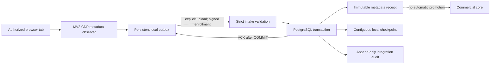

# Adaptive integration architecture and operating limits

Experimental, non-canonical; 2026-11-17. Complements the source-pinned research and independent QA. This does not approve a provider connection or close a Human Gate.

## Implemented boundaries

`product/src/adapters/browser-companion/worker.mjs` serializes local storage mutations and persists a pending request before network I/O. `upload.mjs` binds enrollment, page, capture and local sequence. Origin/page filters and the server grant must both match. Local scope labels alone authorize nothing. Upload is explicit; no background subscription SLA is implied.

`application/integration/intake.ts` verifies a server-issued expiring HMAC capability with fixed workspace/connection/account/page. `infra/integration/pg-integration.store.ts` locks enrollment, checks expiry/revocation after waiting, compares immutable retries and stores receipt/checkpoint/audit in one transaction. `PostgresService.withTransaction` resolves after COMMIT. Unique keys are enrollment/capture and enrollment/sequence; enrollment scope supplies tenant/account binding. Migration 008 has no commercial-truth foreign keys or writes.

The issuer is a privileged sandbox secret, not OIDC or a membership service. Capability is only `observation:append`. Flag off, production/pilot mode, invalid configuration/signature/scope fail closed. Each route has an 8 KiB parser limit. Fastify `onRoute`, registered during Nest middleware configuration, maps route metadata to the actual parser limit. Nest `RouteConfig` alone did not enforce it; QA verified content-length and chunked requests. [Fastify hook contract](https://fastify.dev/docs/latest/Reference/Hooks/#onroute).

## Meaning and recovery

| Concept | Meaning here | Does not prove |
|---|---|---|
| Capture ID | Local observation instance | Provider event identity |
| Receipt ID | Durable backend acknowledgement | CommercialEvent identity |
| Sequence/checkpoint | Contiguous delivered requests within an enrollment | Provider cursor/history coverage |
| Payload hash | Digest retained in filtered metadata | Recoverable immutable raw body |
| Snapshot reconciliation | Bounded state comparison | Replay of offline transitions |
| UNKNOWN | Explicit authenticity/completeness/continuity limit | Healthy/full-replay certification |

An exact duplicate may return a checkpoint later than its sequence; the client still requires exact enrollment/capture/sequence and valid receipt identity. A new sequence cannot skip an earlier request. Gaps, conflicting identity and stale sequences return 409 without advancing the checkpoint. Companion retains and blocks; resolution/reconfiguration is manual, not automatic gap recovery. 401/403 or expiry removes local authority and stops capture. New enrollment cannot relabel a nonempty outbox; export/retention decisions are required first.

Tests cover A→B→A during 15-second and 15-minute offline intervals: an unchanged final snapshot leaves an UNKNOWN gap. Historical private Pancake captures were not independently re-audited. No full replay, no-event-loss or exactly-once claim. No live customer message mutation, webhook subscription or browser cookie export occurred.

## Authorized sandbox runbook

1. Use dedicated PostgreSQL and apply migrations. Generate separate issuer/signing secrets outside Git; configure fixed AIL workspace/account/page and explicit local/test mode. See `data-security.md` for environment names.
2. Issue enrollment using issuer authorization and empty JSON. Transfer only the narrow token to the extension through a trusted procedure. Use a trusted HTTPS origin and explicit optional host permission; issuer secret never enters the extension.
3. Confirm page scope and capture privacy; generate a controlled synthetic or authorized observation. Upload the oldest pending record. Inspect backend receipt/checkpoint/audit. Continuity remains UNKNOWN.
4. On 401/403, stop and inspect expiry/revocation. On 409, retain evidence and investigate order/identity. On 503, retain the same request for retry after recovery. Never synthesize an ACK or use another tenant's grant.
5. Revoke server enrollment to stop intake; disconnect separately removes local authority. Browser-closed operation is unsupported. Preserve metadata export before clearing local state.
6. Disable AIL before application rollback. Migration 008 down deletes experimental records; migration 009 down removes declaration projection columns while retaining the audit. Export/backup decisions precede destructive rollback of retained data. Prefer a forward fix and rehearse restoration first.

`scripts/restore-rehearsal.mjs` uses an explicit local `/north_start_ci` connection, creates uniquely named disposable databases, applies migrations, writes synthetic rows, invokes backup/restore helpers, compares table digests and checks restored receipt uniqueness. Cleanup targets only databases created by that invocation. This proves bounded logical restoration, not PITR, production disaster recovery or agreed RPO/RTO. Small-fixture timing is not an SLA.

## Threats and release conditions

| Observed risk | Current control | Required before commercial exposure |
|---|---|---|
| Tenant/account impersonation | Signed fixed scope and durable enrollment | OIDC, membership, service identity and approved resource grants |
| Replay, revoke race, crash before ACK | Atomic receipt/checkpoint/audit, locks, immutable comparison | Actual COMMIT network-loss/host-kill drills and recovery operations |
| Oversized uploads | Parser cap and bounded local queues/request/ACK | Per-principal/IP quotas and abuse monitoring |
| Browser secrets or PII | Metadata allowlist, no raw bodies/cookies, redacted export | Retention/export/delete, IDs-as-PII policy, extension release review |
| Credential theft | Scoped 15-minute token, revocation, HTTPS opt-in | Vault, rotation and authenticated enrollment issuance |
| Misleading health | Gaps and UNKNOWN surfaced separately | Metrics, alerts, correlation IDs, checkpoint age/backlog dashboards |
| Protocol drift | Pinned evidence and unknown-schema tests | Provider rights and authorized live contract tests |
| Consequential unknown outcome | No mutation runtime enabled | Propose→preview→authorize→execute→verify→audit; no blind retries |

Keep the modular monolith, ports and PostgreSQL. Observed problems require boundary, transaction and operational work; they do not justify Kafka, microservices or full event sourcing. REA remains an investigation instrument outside production authentication, subscriptions and canonical semantics.
