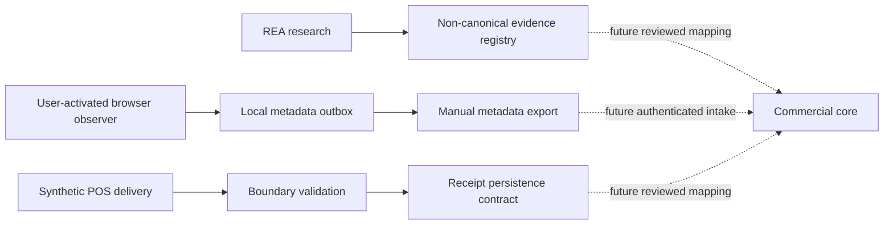

# Adaptive Integration Layer: Pancake research increment

Status: experimental, non-canonical. Date: 2026-11-14.
Branch: `feat/adaptive-integration-pancake-research`, based on `12aabd1`.

Latest consolidated report (2026-11-15): [Tri thức, kiểm chứng, baseline và kế hoạch hoàn thiện Pancake](pancake-evidence-and-completion-2026-11-15.vi.md).
New live evidence includes guarded conversation tag attach/detach, the actual
`pages:tag_conversations` batch shape, a change during a transport gap, linked POS
shop/automation reads, and bounded message/history pagination. Companion is now
0.1.2. Full suite: 397 passed, 21 PostgreSQL skipped; targeted AIL: 59 passed;
application E2E: 7 passed. PH4 remains OFF and all 12 research capabilities remain
production-unapproved. See the consolidated report for failures and dependencies.

Previous checkpoint: [Reconnect, conversation contracts and decoder fixes](pancake-continuity-and-contracts-2026-11-15.vi.md).
A bounded WebSocket fault now verifies socket closure, local retry rejection,
Facebook page-channel rejoin and unchanged conversation snapshots. Replay remains
UNKNOWN. Source-derived deletion mapping and payload page checks were fixed in
both decoders; Companion revision is 0.1.1. Full suite: 394 passed, 21 PostgreSQL
skipped; research runner tests: 9 passed.

Previous update: [Facebook settings experiment, cleanup, fixes and next steps](pancake-research-2026-11-15.vi.md).
An authorized temporary tag was created and deleted through Pancake UI. HTTP
success, Facebook-scoped `pages:update_settings`, readback and reload verification
agree; all six original tags were restored. Provider counters advanced and two
previously absent call-tag fields became empty arrays. This verifies a narrow
settings capability, not message-stream reliability or production readiness.

New evidence: [User-authorized browser session and supplied HAR](authorized-session-and-har.vi.md)
records confirmed Phoenix control tuples in a historical capture and HTTP 200
Facebook reads in the user's newly authenticated browser. Business-event delivery
and production approval remain unverified.

Follow-up status: [Vietnamese progress report and next plan](progress-and-next-plan.vi.md).
That review reproduced a lifecycle bug: `auth-expired -> disconnected ->
connected` cleared the expiry block. Fixed on 2026-11-15 with four regression
sequences including checkpoint restore; full suite: 387 passed, 21 PostgreSQL
skipped. The prototype is not a production authorization boundary.

This increment implements the first research/fixture slice of P1 + P2 + P3.
It does not approve a production connector, change a canonical invariant,
resolve an OPEN decision, or pass the gate before PH4.

## Findings that change implementation choices

1. **Pancake relay is a protocol reference, not a durable connector.** At
   `23e2409f6c80e910de6f652b4c9d0a878ba2291b`, `src/phoenix-client.ts`
   implements Phoenix tuples, heartbeat and reconnect for `pages:<page>` topics.
   `src/event-handler.ts` deduplicates conversation updates using object ID plus
   message count within 500 ms. Status/assignment changes can have the same
   message count. North Star therefore never uses that count as event identity.

2. **The streaming example can acknowledge before durable delivery.** At
   `3dd868612dc73d2be4ada01c249fc673553b0a9c`, `gateway/main.py` returns success
   after `produce_event`; `gateway/producer.py` only calls `produce` and
   `poll(0)`. Kafka delivery failure is logged asynchronously. The consumer's
   `_send_to_dlq` does not check the number of undelivered records returned by
   `flush(10)` before committing offsets. README also says real webhook
   registration awaits provider enablement. Do not inherit its delivery claims.

3. **Official POS webhook configuration differs from the MCP example.**
   The retrieved official contract is `PUT /shops/{SHOP_ID}` with
   `shop.webhook_types`: `orders`, `customers`, `products`,
   `variations_warehouses`, `einvoices`, `auto_call`. The TypeScript MCP repo
   offers CRUD on `webhooks` with examples `order.created`/`order.updated`.
   That source is not evidence that those operations are supported by POS.

4. **Configured secret headers are documented; current app HMAC is not.**
   POS documents POST JSON, configured request headers, a 2xx response within
   30 seconds, retries after 10 minutes then another 30 minutes, and API-based
   recovery. POS Apps data-access docs place per-app webhook subscriptions with
   HMAC signatures in planned phase 2. The fixture harness tests configured
   headers and waits for a persistence acknowledgement. It invents no HMAC scheme.

5. **`pos.on('data-change')` is a context event.** Official runtime docs say it
   includes detail-form edits (batched over 300 ms) and page path changes. It is
   not proof of a saved order, provider-confirmed transition or commercial outcome.
   Apps run only while somebody has POS open. User permission intersected with
   app access bounds a short-lived app token; this is separate from backend keys.

6. **Some official payload definitions remain incomplete.** The retrieved
   `schemas.md` has descriptions but no fields for `WebhookOrderResponse` and
   `WebhookCustomerResponse`. `WebhookProductResponse` describes
   `data.record` and `data.success`. The receiver retains synthetic raw bytes
   as uninterpreted receipts instead of fabricating an order/event/version mapping.

7. **Browser capture observed WebSocket activity, with material gaps.**
   REA evidence `ev_56365417caaafae0d06e896e62673dd53afdba9d95951f34750796970b896474`
   retained two socket openings, two sent frames and two received frames in
   19,596 ms. It also dropped 10,301 events; the local HTTP guard blocked 6,190
   non-read requests. Blocking application POSTs triggered extensive retries.
   This establishes browser WebSocket activity only. Authentication, transport
   identity, business event type, payload and completeness remain UNKNOWN.
   Later runs now stop at 100 blocked requests or 500 total requests.

Source URLs, pinned revisions and file digests are in
[source-ledger.json](source-ledger.json). Capability claims and remaining unknowns
are in [protocol-capability-registry.json](protocol-capability-registry.json).
The local summary is [live-summary.json](live-summary.json); it is an aggregate
derivative, not the full REA evidence. Original cookies and raw CLI output are
not part of these artifacts.

## What is implemented

| Component | Location | Behavior |
|---|---|---|
| Phoenix observation decoder | `product/src/adapters/adaptive-connectivity/phoenix-observer.ts` | Validates tuple shape, frame size, direction, selected page scope and known event types; retains hashes and identifiers, not payload bodies |
| Observation assurance | `product/src/adapters/adaptive-connectivity/continuity.ts` | Serializable state, scoped delivery retry detection, conflict detection, ordering signal, expiry stop and persistent UNKNOWN gaps |
| POS fixture receiver | `product/src/adapters/adaptive-connectivity/pos-webhook-fixture.ts` | Synthetic raw JSON intake, configured-secret comparison, size/UTF-8 validation, acknowledgement only after sink confirmation |
| Receipt persistence contract | `product/src/ports/research-receipt.port.ts` | Atomic append/dedup/conflict contract; no production storage implementation supplied |
| Browser Companion | `product/src/adapters/browser-companion/` | Native MV3, explicit start/stop, selected tab/page, received WebSocket metadata, local persistent outbox, metadata export |
| Research runner | `product/scripts/ail/facebook-research-scenario.mjs` | Existing local session, pinned original target, bounded generated UI mutations, Facebook scope guard, readback, disposable-tab socket fault and private evidence |
| Browser smoke test | `product/scripts/ail/companion-browser-smoke.mjs` | Real Chromium extension + local TLS/WebSocket fixture, privacy check and persistence across browser restart |



There is no new application composition wiring, public HTTP endpoint, standalone
private-protocol connection, cookie upload or message send. Later authorized UI
research performs bounded Facebook tag mutations and rollback; those experiments
are separate from the local-only Companion and the production application.
The existing Pancake read adapter remains separate and disabled by default.

## Identity, persistence and trust

- Workspace, connection, account and provider surface form the scope. The page
  channel is explicitly selected. These local labels are research context, not
  authentication or proof of North Star tenant membership.
- A `captureId` identifies one observation delivery. Retrying that ID with changed
  content is a conflict. Two identical frames with different capture IDs are
  retained: absent a provider event ID, they may represent distinct events.
- Browser records remain `client-observed`, authenticity/completeness UNKNOWN.
  A received frame is not promoted to a confirmed provider or commercial event.
- The POS harness remains `synthetic` and `uninterpreted`, even with a correct
  configured header. Each connection must get its own secret before live use.
- Caller-managed continuity state requires atomic persistence with an accepted
  observation before acknowledging it. The reducer alone is not a durable queue.
- Unknown gaps survive reconnect and restart. No current path asserts complete
  reconciliation. Reauthorizing an expired continuity session requires a new
  authorized connection identity; no autonomous refresh is implemented.
- Browser outbox stores at most 1,000 records. Capture stops on full storage,
  oversized frames, backlog, authorization failure, detach or scope departure.
  Export is a local snapshot and does not acknowledge backend delivery or clear
  stored evidence. Remove extension data explicitly when no longer needed.

## Run and inspect

From `product/`:

```powershell
npm run test:ail
npm run test:companion
npm run typecheck
npm run lint
npm run architecture:check:strict
npm run build
npm test
```

The browser smoke test needs installed Playwright Chromium and OpenSSL. On this
Windows workstation it uses Git's bundled OpenSSL. Set `AIL_OPENSSL` for another
installation. It generates a one-day test certificate and an isolated profile in
ignored `product/.tmp/`, redirects `pancake.vn` only inside that test browser to
its local TLS server, and closes all owned sockets and browser processes.
It does not contact Pancake and supplies no real credentials.

To inspect the extension, load unpacked
`product/src/adapters/browser-companion/` in a separate browser profile. Open the
Pancake tab, enter research scope and the selected page ID in the popup, then
start. Chrome shows its debugger warning. The extension requests `debugger`,
`storage`, and `activeTab`; no cookies, content scripts or broad host permission.
The debugger permission is powerful; per-tab/page filtering is implemented by
the extension, not by a provider-issued authorization scope.

Capture only sees socket activity observable after activation. No historical
frames, worker-target attachment or reconnect guarantee is claimed. Avoid
reloading a live provider merely to generate evidence without considering its
application-side effects. The observer does not block the user's own actions.

The original `pancake-discovery.mjs` command is historical. Do not rerun it: its broad
POST guard caused application retries. Current research uses the bounded
`facebook-research-scenario.mjs` runner and the existing local profile; private
specifications and captures are intentionally excluded from Git.

Current captures can contain customer data in response bodies, DOM and raw frames;
they remain under ignored `docs/login_info/`, not in public reports or fixtures.
Cookie values are passed to REA as environment secret references. Redaction and
literal-value scans are guardrails, not a guarantee that arbitrary capture data
is safe to publish. The runner requires the local REA installation/profile and
remains a workstation research tool, not a 24/7 connector.

## Initial checkpoint verification and limits (superseded by latest report)

- Targeted suite: 45 tests passed at this checkpoint.
- New adaptive-connectivity TypeScript code: 100% line coverage, 95.88% branch
  coverage in the targeted V8 run. This does not cover extension JavaScript;
  its worker logic has separate tests plus the real Chromium smoke test.
- Real Chromium MV3: received a synthetic WebSocket frame, excluded message text
  from persistent storage, retained metadata across browser restart.
- The browser smoke seeds the trusted worker configuration to test CDP and
  storage. It does not establish end-to-end human consent/UI authorization.
- Typecheck, lint, strict architecture check, registry validation and build passed.
  Final full suite: 383 passed, 21 PostgreSQL integration tests skipped because
  this run did not provide `TEST_DATABASE_URL`. No database migration is added.
- Third-party source was inspected only; no dependencies installed or code run
  from the reference repos. No third-party source implementation was copied.
- Missing licenses are recorded as UNKNOWN; source availability is not permission
  to redistribute or operate a private provider protocol.

## Remaining work and adoption gates

| Priority | Remaining evidence/action | Completion criterion |
|---|---|---|
| P1 | Authorized conversation change, reload/reconnect/expiry captures | Correlated event shapes and capture coverage, provider/account scope, documented replay limits |
| P2 | Real POS shop/API credentials, webhook registration and complete payload samples | Provider-delivered receipt, configured-source checks, durable persistence, duplicate/order tests and reconciled outage window |
| P3 | Authenticated North Star intake and tenant-bound connection enrollment | Signed/scoped enrollment, revocation, transactional ACK, upload retries, retention and user-consent flow tests |
| P3 | Extension publication/build/release lane | Permission review, packaging, full UI tests, threat review and version drift tests |
| Later | Meta, TikTok LIVE/Shop/Business, Google surfaces | Per-surface contracts; no inference from a different product's transport |
| P7 | Delegated action execution | Preview, authorization, approval, provider verification and audit receipts; currently absent |

The supplied file contains browser cookies, not POS API keys. No API key was
generated and no webhook configuration was changed. Broader provider references
remain research backlog; repository HEAD discovery alone is not source or live
verification. Commercial core semantics and PH4 approval remain unchanged.
